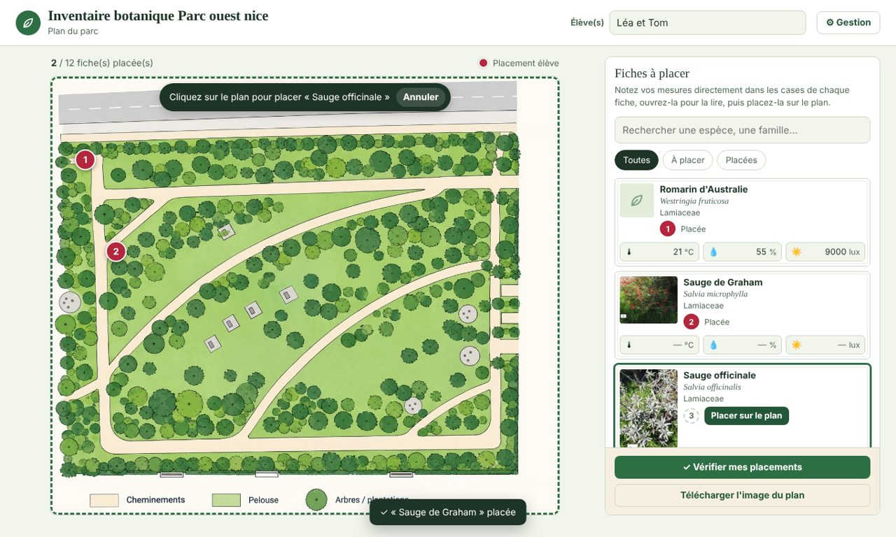

# Inventaire botanique

Application web pour les sorties de terrain : l'enseignant prépare des **fiches d'espèces**
(photos, besoins de la plante, description) et leur **position réelle sur un plan** ; les élèves
lisent les fiches, notent leurs **mesures** (température, hygrométrie, éclairement), **placent**
chaque plante sur le plan, puis vérifient leurs placements et téléchargent un **compte rendu en JPG**.



- Guide d'utilisation (enseignant et élèves) : [docs/GUIDE.md](docs/GUIDE.md)
- Fonctionnement interne, format des données : [docs/ARCHITECTURE.md](docs/ARCHITECTURE.md)
- Exigences du projet (source de vérité) : [docs/CAHIER_DES_CHARGES.md](docs/CAHIER_DES_CHARGES.md)
- Grande mise à jour en préparation : [docs/FEUILLE_DE_ROUTE.md](docs/FEUILLE_DE_ROUTE.md)

## En bref

- **Aucune dépendance à l'exécution** : HTML, CSS et JavaScript (modules ES) écrits à la main.
  `esbuild` ne sert qu'à produire la version en un seul fichier ; `prettier` qu'à formater.
- **Deux façons de l'utiliser** :
  1. **Fichier autonome** : un seul `.html` à ouvrir d'un double-clic, sans serveur ni connexion
     (c'est ainsi que le projet a commencé) ;
  2. **Hébergé** : la même page servie par un serveur web, le projet dans `project.json` ; les élèves
     y accèdent par une adresse.
- **Les données restent dans le navigateur** (IndexedDB) : le travail des élèves n'est jamais
  envoyé sur le serveur. Seul l'enseignant publie le projet.
- **Thèmes** de couleurs et icône réglables, pour d'autres sujets que les plantes.

## Démarrer

Prérequis : Node.js 24 (`nvm use` lit le fichier `.nvmrc`).

```bash
npm install          # outils de développement (esbuild, prettier)
npm run dev          # http://localhost:8080 — sert src/ sans construction, données dans .dev-data/
npm test             # tests (modèle, tableur, mots de passe, serveur, base de données, comptes)
npm run test:e2e       # parcours dans un vrai navigateur (une fois : npx playwright install chromium-headless-shell)
npm run test:coverage  # les deux, avec la couverture par fichier et ses seuils
npm run test:mutants   # casse le code exprès et vérifie que les tests le voient (plusieurs minutes)
npm run build        # dist/index.html : application complète en un seul fichier
npm start            # sert dist/ et data/ comme en production
```

En développement, la page charge `src/js/main.js` en module ES : modifiez un fichier et rechargez.
Mot de passe de gestion par défaut : `admin`.

## Héberger

### Avec le petit serveur fourni (recommandé)

`server/index.mjs` (Node, sans dépendance) sert l'application, les projets, et permet à
l'enseignant de **publier** ses modifications depuis l'application.

```bash
npm ci && npm run build
PUBLISH_PASSWORD='un-mot-de-passe-solide' node server/index.mjs --root dist --data data
```

| Variable           | Rôle                                                                 | Défaut  |
| ------------------ | -------------------------------------------------------------------- | ------- |
| `PORT`             | port d'écoute                                                        | `8080`  |
| `ROOT`             | dossier de l'application construite                                  | `dist`  |
| `DATA_DIR`         | dossier des données (`app.db`, `project.json`, `projets/<nom>.json`, `backups/`) | `data`  |
| `PUBLISH_PASSWORD` | mot de passe de publication ; absent = publication désactivée         | —       |
| `MAX_BODY_MB`      | taille maximale d'un projet publié (photos comprises)                 | `100`   |
| `ADMIN_EMAIL`, `ADMIN_PASSWORD` | créent le compte admin au premier démarrage, s'il n'existe pas ; sans elles, il n'y a pas d'admin | — |
| `TRUST_PROXY`      | `1` si un proxy est placé devant : l'IP du client est lue dans `X-Forwarded-For`. Sans proxy, ne pas le définir : n'importe qui pourrait choisir son IP | — |

Avec Docker :

```bash
docker compose up -d     # voir docker-compose.yml (changez PUBLISH_PASSWORD)
```

Le dossier `data/` est un volume : il contient la base `app.db`, les projets et leurs sauvegardes
automatiques dans `data/backups/` (les 20 dernières versions de chaque projet, une copie de la base
par jour pendant 14 jours). Il ne fait pas partie du dépôt,
et l'image ne contient aucun projet : sur un volume vide, déposez un `project.json` dans `data/` pour
que l'application propose de publier.

Mettez un proxy **HTTPS** devant (Caddy, Traefik, nginx). Exemple Caddy :

```
inventaire.example.fr {
  reverse_proxy localhost:8080
  request_body { max_size 100MB }
}
```

### Comptes

L'espace enseignant est à l'adresse `/prof`, le tableau de bord de l'admin à `/admin`. L'admin crée un lien de création
de compte et le transmet lui-même : l'application n'envoie pas d'e-mail. Derrière un proxy HTTPS, `TRUST_PROXY=1` est
nécessaire pour que le cookie de session porte `Secure`.

Mot de passe de l'admin perdu : lancez cette commande sur le serveur, puis ouvrez le lien affiché après l'adresse du site.

```bash
docker compose exec inventaire node server/admin-reset.mjs
```

### Sur un hébergement statique (nginx, Apache, GitHub Pages…)

Copiez `dist/index.html` et un `project.json` côte à côte. Sans serveur de publication,
l'enseignant télécharge `project.json` depuis l'application (onglet **Projet**) et vous le
déposez à la main. Facultatif : un `config.json` à côté de la page :

```json
{ "projectUrl": "project.json", "publishUrl": null }
```

### Plusieurs projets

`https://…/?projet=rocaille` charge `projets/rocaille.json` (et publie vers
`/api/project?projet=rocaille`). Noms autorisés : lettres, chiffres et tirets.

### Récupérer un projet existant

Les fichiers `.html` enregistrés par les anciennes versions contiennent leur projet :

```bash
npm run convert -- "Inventaire botanique 5.html" data/project.json
```

L'enseignant peut aussi ouvrir l'application hébergée, passer en Gestion › Projet ›
**Ouvrir un projet**, choisir son ancien fichier, puis **Publier**.

## Sécurité : ce qu'il faut savoir

- `project.json` est **public** (les élèves le téléchargent) : n'y mettez rien de confidentiel.
- Le mot de passe **de gestion** ne fait qu'empêcher les modifications accidentelles : son
  empreinte est dans le projet, donc lisible. La protection réelle est le **mot de passe de
  publication**, vérifié par le serveur (comparaison à temps constant, 10 essais / 10 min / IP ;
  derrière un proxy, définir `TRUST_PROXY=1` pour que l'IP soit bien celle du client).
- Le serveur refuse les chemins sortant de `ROOT` et `DATA_DIR`, vérifie le format du projet
  publié et écrit de façon atomique.
- L'identification par IA (facultative) appelle une adresse fournie par l'enseignant : ne mettez
  jamais de clé d'API dans l'application, passez par votre propre service.

## Organisation du code

```
src/
  index.html            structure de la page et des fenêtres
  css/app.css           toute la mise en forme (variables de thème en tête)
  assets/               plan d'exemple
  js/
    main.js             démarrage
    model.js            format des données, migrations, calculs (pur, testé)
    store.js            état de l'application, enregistrement dans le navigateur
    db.js               IndexedDB (+ lecture des données des anciennes versions)
    project-io.js       choix du projet au démarrage, fichiers, version élèves, publication
    render.js           rafraîchissement de l'écran
    themes.js           thèmes de couleurs et icônes
    report.js           plan et compte rendu en JPG
    spreadsheet.js      import / export tableur (CSV, .xlsx via xlsx.js)
    auth.js  ai.js  util.js  api.js
    prof/  admin/  compte/   espace enseignant, tableau de bord, liens à usage unique
    views/              en-tête, plan, panneaux, fenêtres (fiche, édition, résultats…)
      admin/            onglets du mode gestion
server/
  index.mjs             démarrage : options, sauvegarde quotidienne, arrêt propre
  app.mjs               assemble la base, les routes et les fichiers statiques
  http.mjs              routage, corps des requêtes, JSON, fichiers (ETag, gzip)
  db.mjs                SQLite, migrations (migrations/*.sql), copies de la base
  security.mjs          IP du client, limites d'essais
  auth.mjs              mots de passe, sessions, liens à usage unique, rôles
  admin-reset.mjs       lien de réinitialisation pour l'admin, à lancer sur le serveur
  routes/auth.mjs, admin.mjs, pages.mjs   connexion, tableau de bord, pages des espaces
  routes/legacy.mjs     projet unique et publication, jusqu'aux espaces enseignants
scripts/                construction, conversion, couverture des tests
tests/                  tests node:test ; e2e/ pour les parcours dans le navigateur
```

Détails dans [docs/ARCHITECTURE.md](docs/ARCHITECTURE.md).
