# Guide d'utilisation de Cartopoint

Cartopoint sert aux sorties de terrain. L'enseignant prépare des fiches et leur position sur un plan. Les élèves les retrouvent sur place, notent leurs mesures et placent
chaque fiche sur le plan, depuis leur téléphone. À la fin du cours, chacun reçoit sa correction, et l'enseignant garde les résultats de la classe.

Les captures de ce guide montrent un cours inventé.

**Le déroulement d'un cours, en bref**

1. L'enseignant prépare le cours et le **publie**.
2. Il le **lance** : un QR code et un code à taper apparaissent.
3. Les élèves rejoignent et attendent le message **✓ Prêt pour le terrain**. Ils peuvent alors quitter le réseau.
4. Ils placent leurs fiches, puis cliquent sur **Terminer**.
5. L'enseignant clique sur **Terminer le cours** : les élèves reçoivent leur correction.
6. L'enseignant télécharge les résultats quand il veut, pendant un an.

---

## 1. Pour l'enseignant

### Créer son compte

L'administrateur du site vous transmet un lien de création de compte, valable 7 jours et une seule fois : l'application n'envoie aucun e-mail. Ouvrez-le, choisissez votre adresse et
votre mot de passe. Ensuite, votre espace est à l'adresse du site, en cliquant sur **Espace enseignant**.

### Mes cours

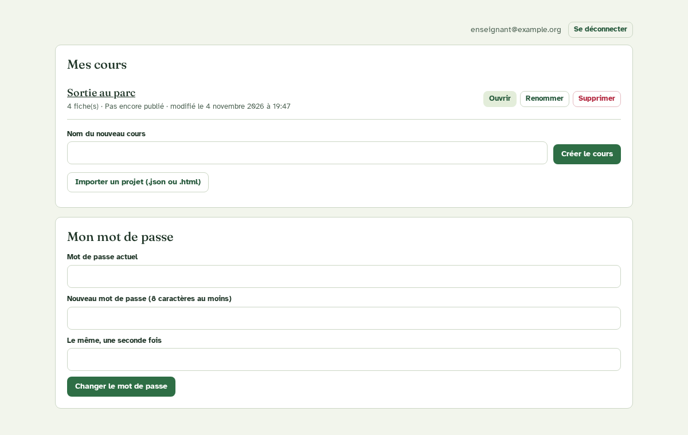

Donnez un nom à un nouveau cours et cliquez sur **Créer le cours**.

**Importer un projet** reprend un fichier `.json` ou `.html` enregistré avec l'ancienne version, photos et positions comprises. Le cours importé est le vôtre : les élèves n'y ont pas
accès tant que vous ne l'avez pas publié.

### Préparer le cours

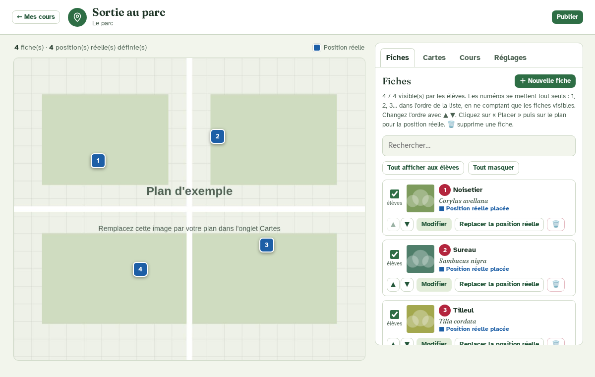

Vos modifications s'enregistrent au fur et à mesure. Les élèves n'en voient rien tant que vous n'avez pas publié.

**Onglet Fiches**

- **Nouvelle fiche**, puis **Modifier** : noms, besoins de la plante, description, photos et vidéos. On choisit la photo qui sert de vignette.
- **Placer la position réelle** : cliquez, puis cliquez sur le plan à l'emplacement réel. La position réelle est un **carré bleu**, qui peut se déplacer à la souris.
- **Case « élèves »** : la fiche est montrée aux élèves ou non. Une fiche masquée ne leur parvient jamais.
- **Numéros** : ils se mettent tout seuls, dans l'ordre de la liste, en ne comptant que les fiches visibles. Les flèches **▲ ▼** changent l'ordre.
- **Importer un tableau** : des fiches préparées dans Excel, LibreOffice ou Google Sheets. Le **modèle** se télécharge juste à côté. Préférez le format `.xlsx`, qui garde les émojis. Une
  fiche qui existe déjà (même réf. photo, ou à défaut même nom) est complétée au lieu d'être créée en double.

**Onglet Cartes**

- **Changer l'image** du plan, ou **Ajouter une carte** : chacune garde ses fiches.
- **Échelle** : la largeur réelle du terrain, en mètres. Les écarts des élèves sont alors donnés en mètres, sinon en pourcentage de la largeur du plan.

**Onglet Réglages**

- **Apparence** : thème de couleurs et icône, pour un autre sujet que les plantes. Les élèves voient le thème choisi.

### Publier et lancer

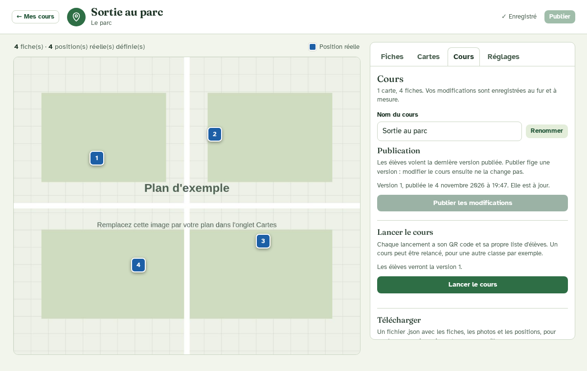

Dans l'onglet **Cours** :

1. **Publier les modifications** fige une version. Modifier le cours ensuite ne la change pas, tant que vous ne publiez pas de nouveau.
2. **Lancer le cours** ouvre un lancement : une séance avec une classe, avec son QR code et sa propre liste d'élèves. Un même cours peut être lancé plusieurs fois, pour plusieurs classes.

### Pendant le cours

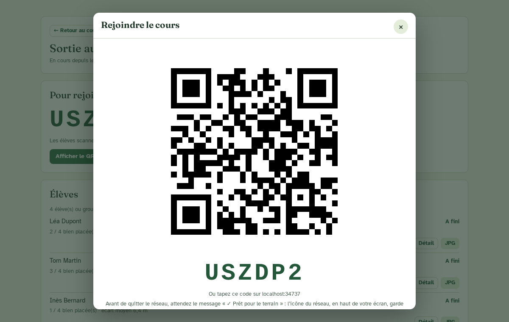

**Afficher le QR code** le montre en grand, avec le code à taper. Les élèves le scannent avec l'appareil photo de leur téléphone, ou tapent le code sur l'adresse du site.

Prévenez-les : **il faut attendre le message « ✓ Prêt pour le terrain »** avant de quitter le réseau. C'est à ce moment que le plan et les photos sont sur leur téléphone. Les vidéos, elles,
restent consultables en ligne seulement.

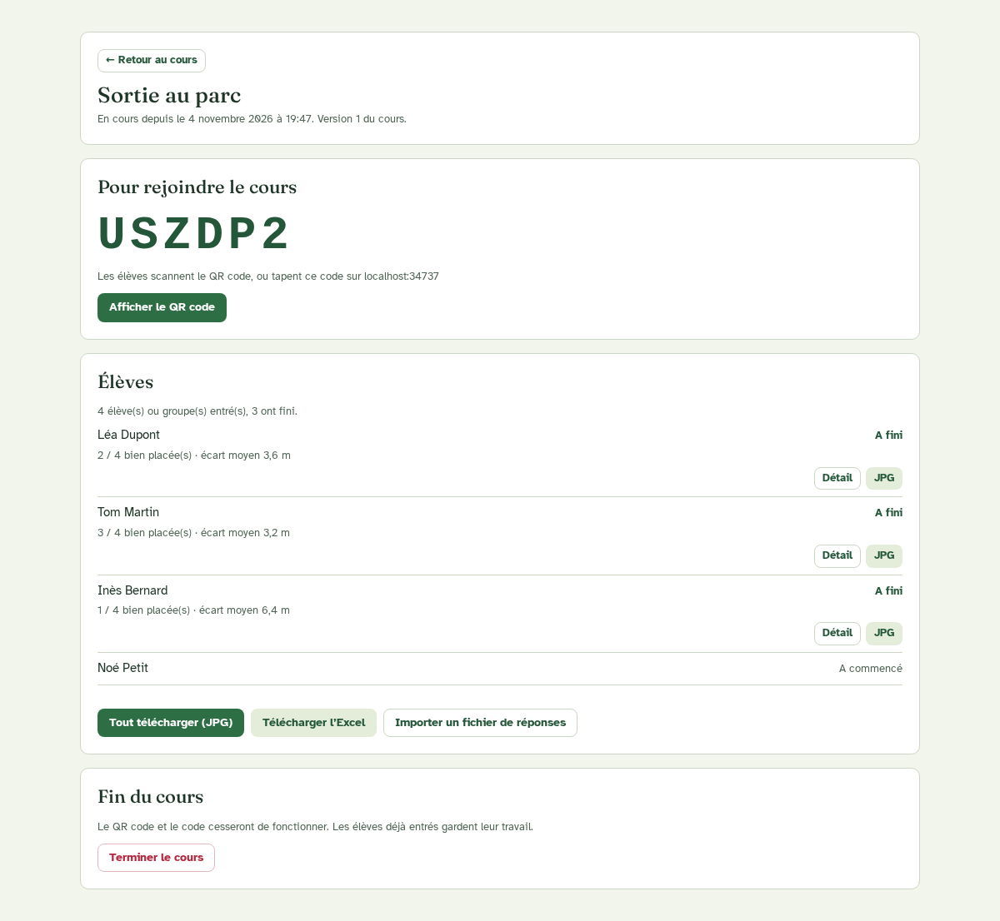

La liste se met à jour toute seule : qui a commencé, qui a fini, et à quel résultat. Vous pouvez fermer cette page et la retrouver plus tard dans l'onglet **Cours**, ou par **Suivre le cours**
dans **Mes cours**.

### Terminer le cours

**Terminer le cours** ferme le QR code et le code : plus personne ne peut entrer. Le travail de chaque élève encore à l'écran se fige, et les élèves reçoivent leur correction.

Un élève sans réseau à ce moment-là garde son travail : ses réponses partent dès que le réseau revient. Chaque réponse étant datée, celles faites après la fin restent comptées, et la liste
vous dit combien il y en a.

### Les résultats

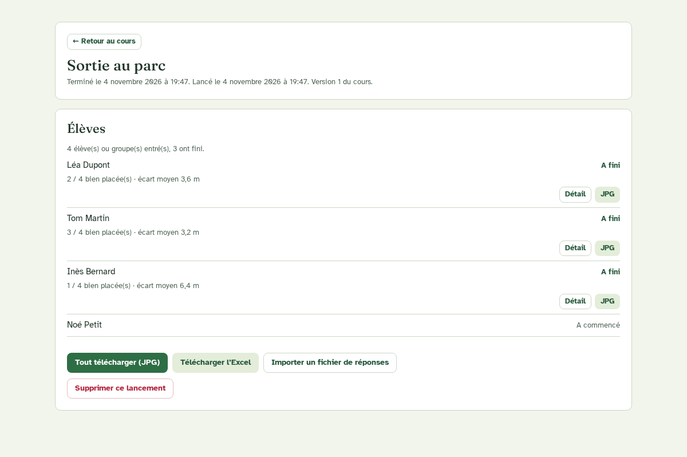

- **Détail** : les réponses d'un élève, fiche par fiche, et le plan avec les écarts.
- **JPG** : le compte rendu d'un élève, à imprimer et à lui rendre. **Tout télécharger (JPG)** les réunit dans une archive `.zip`.
- **Télécharger l'Excel** : une première page **Synthèse**, avec par élève le score, la précision moyenne et la moyenne des trois mesures, puis une ligne par fiche. Suit une page par élève,
  avec toutes ses réponses.
- **Importer un fichier de réponses** : le fichier d'un élève dont l'envoi n'a jamais abouti (voir plus bas).
- **Supprimer ce lancement** : efface la liste et les réponses pour de bon. Sinon, elles sont effacées d'elles-mêmes au bout d'un an.

Vous retrouvez chaque lancement dans l'onglet **Cours**, avec le jour et l'heure où il a été lancé.

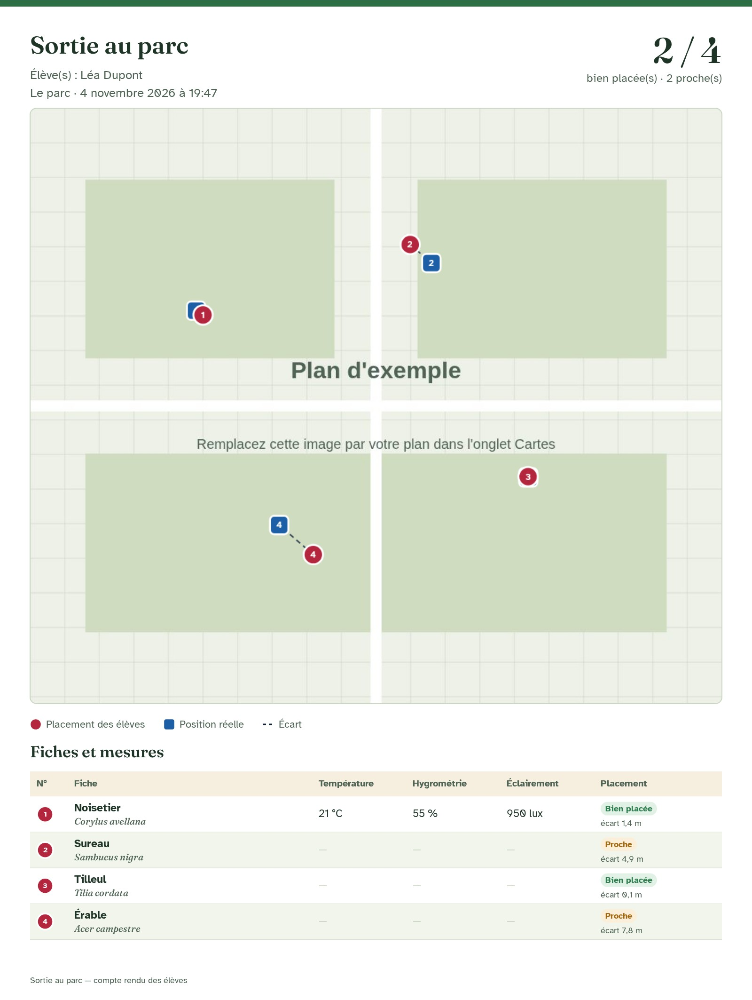

### Le fichier de secours

Si le site tombe en panne un jour de sortie : dans l'onglet **Cours**, **Télécharger le fichier de secours (.html)** donne un seul fichier, à préparer **à l'avance**. Il s'ouvre d'un double-clic,
sans serveur ni réseau, plan et photos compris.

- Vous lui choisissez un mot de passe de gestion, 4 caractères au moins. Le site ne le garde pas : notez-le.
- Sans serveur, c'est le fichier qui corrige : **il contient les positions réelles**, qu'un élève curieux peut y trouver. Chacun y vérifie ses placements lui-même.
- Rien n'arrive dans vos résultats : les élèves vous rendent leur compte rendu en JPG.

**Télécharger le cours (.json)**, juste au-dessus, donne une copie du cours, à garder ou à importer ailleurs.

---

## 2. Pour les élèves

### Rejoindre le cours

Scannez le QR code affiché par l'enseignant, ou ouvrez l'adresse du site et tapez le code.

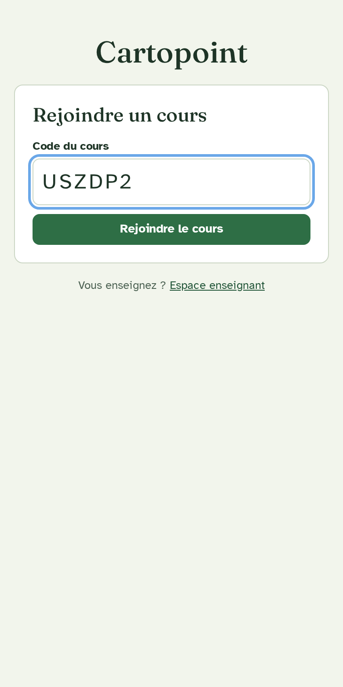 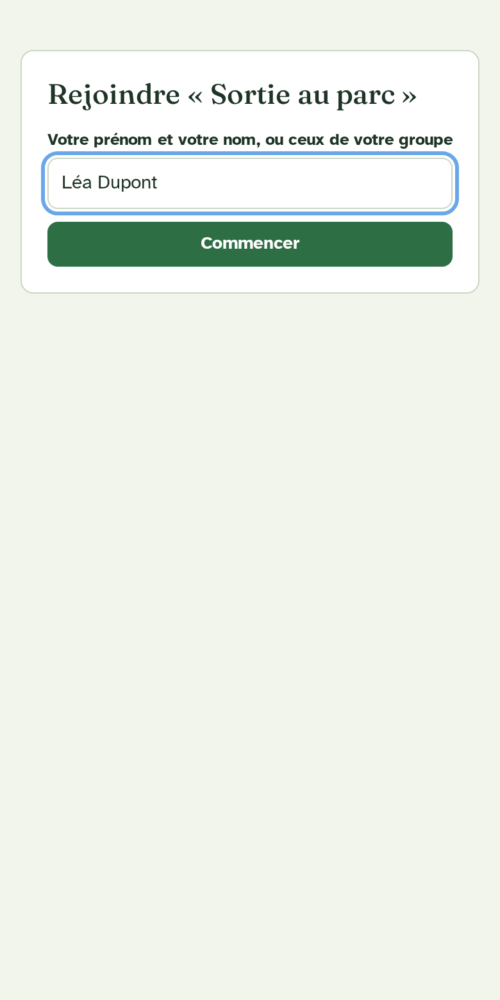

Écrivez votre prénom et votre nom, ou ceux de votre groupe : c'est ce que verra l'enseignant. Il n'y a pas de compte à créer.

### Avant de quitter le réseau

Attendez le message **✓ Prêt pour le terrain**. L'icône du réseau, en haut à droite, garde ensuite une coche. Touchez-la pour lire le détail. Après, vous pouvez travailler sans connexion, et même
recharger la page.

Si l'icône signale un problème, restez sur le réseau et lisez ce qu'elle dit.

### Placer les fiches

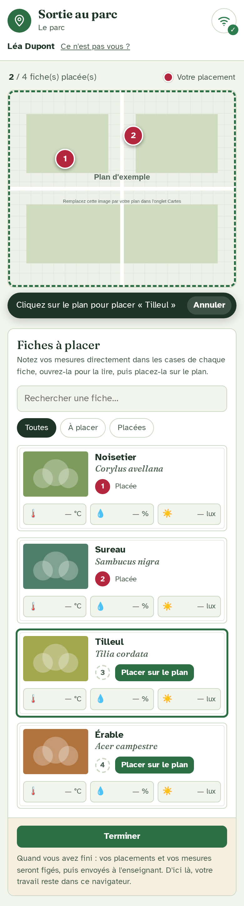

- **Placer sur le plan**, puis touchez l'endroit voulu. Un rond rouge portant le numéro de la fiche apparaît. Le bandeau sous le plan rappelle quelle fiche vous placez.
- Un rond peut se déplacer ensuite, au doigt ou à la souris.
- Touchez le nom d'une fiche pour la lire en grand : photos, famille, besoins, description.
- Notez vos **mesures** (température, hygrométrie, éclairement) dans les petites cases de chaque fiche. Tout s'enregistre tout seul, sur votre téléphone.
- **Toutes / À placer / Placées** et la recherche aident quand il y a beaucoup de fiches.

### Terminer

**Terminer** fige votre travail et l'envoie à l'enseignant. Vous ne pourrez plus le modifier.

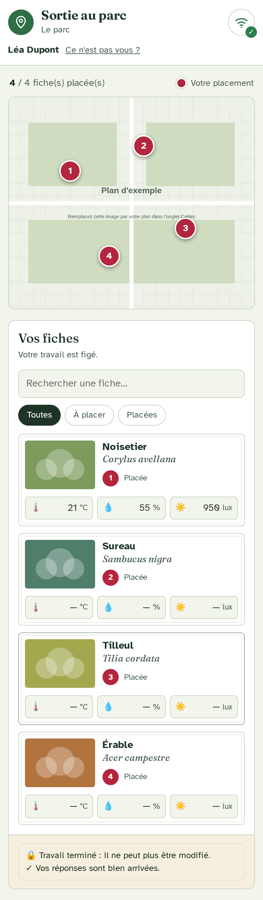

- Sans réseau, vos réponses restent sur le téléphone et partent toutes seules dès que le réseau revient. **Gardez la page.**
- Si l'envoi n'aboutit pas, **Télécharger mes réponses, à donner à l'enseignant** vous donne un fichier à lui transmettre.
- Si l'enseignant termine le cours avant vous, votre travail se fige à ce moment-là, et ce que vous aviez fait est envoyé.

### La correction

Quand l'enseignant termine le cours, votre correction arrive sur votre page : **Voir ma correction**.

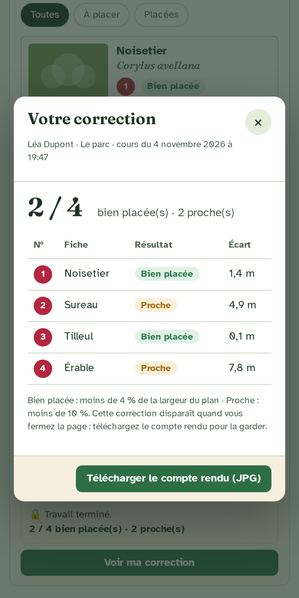

Chaque fiche indique **Bien placée** (moins de 4 % de la largeur du plan), **Proche** (moins de 10 %) ou **À revoir**, avec l'écart.

**Télécharger le compte rendu (JPG)** vous donne une image à garder. **La correction disparaît quand vous fermez la page** : téléchargez-la si vous voulez la conserver.

---

## 3. Pour l'administrateur

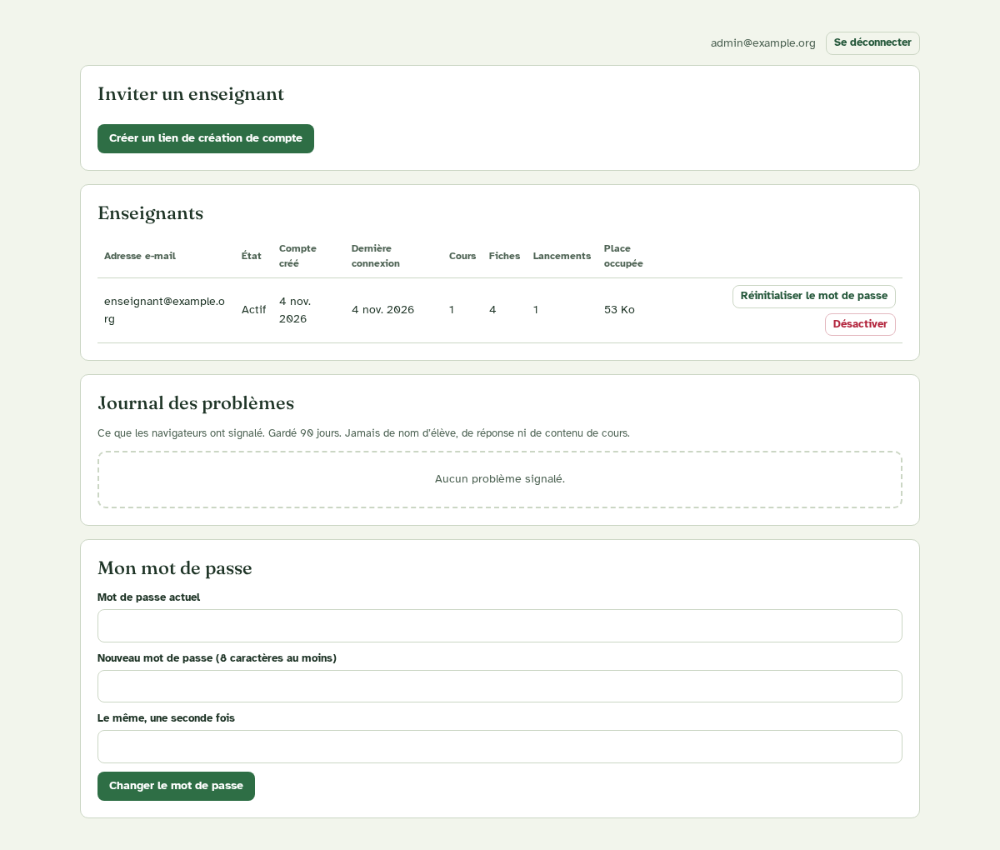

Le tableau de bord est à l'adresse `/admin`. Ce compte sert à gérer le site et n'a pas de cours : pour enseigner, créez-vous un second compte.

- **Créer un lien de création de compte**, à transmettre vous-même à l'enseignant.
- **Enseignants** : leurs cours, leurs lancements, la place occupée. **Réinitialiser le mot de passe** crée un lien à leur transmettre. **Désactiver** bloque le compte sans rien effacer.
- **Journal des problèmes** : ce qui a échoué dans un navigateur, avec la raison et la machine, sans nom d'élève ni réponse. **Télécharger le journal (.log)** le donne en un fichier.

---

## 4. Bon à savoir

- **Sur un téléphone partagé**, « Ce n'est pas vous ? » permet à quelqu'un d'autre d'entrer sous son nom. Le travail précédent n'est alors plus accessible depuis ce navigateur.
- **Le serveur conserve le nom et les réponses des élèves** jusqu'à ce que vous supprimiez le lancement, et un an au plus. L'établissement doit en être informé.
- **Le journal des problèmes** note des informations techniques sur l'appareil (navigateur, système, écran), y compris celui d'un élève, sans dire de qui il s'agit.
