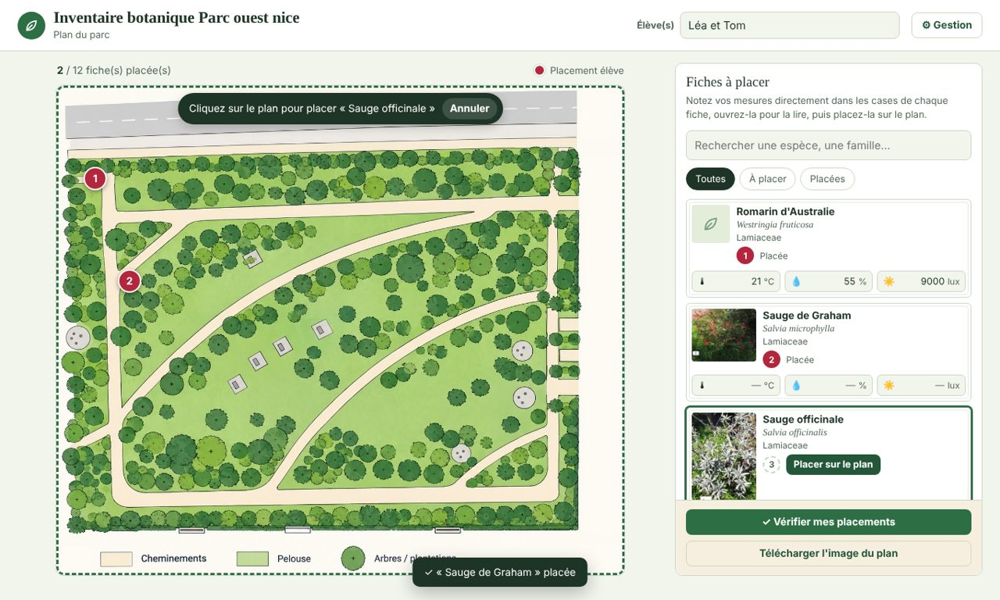
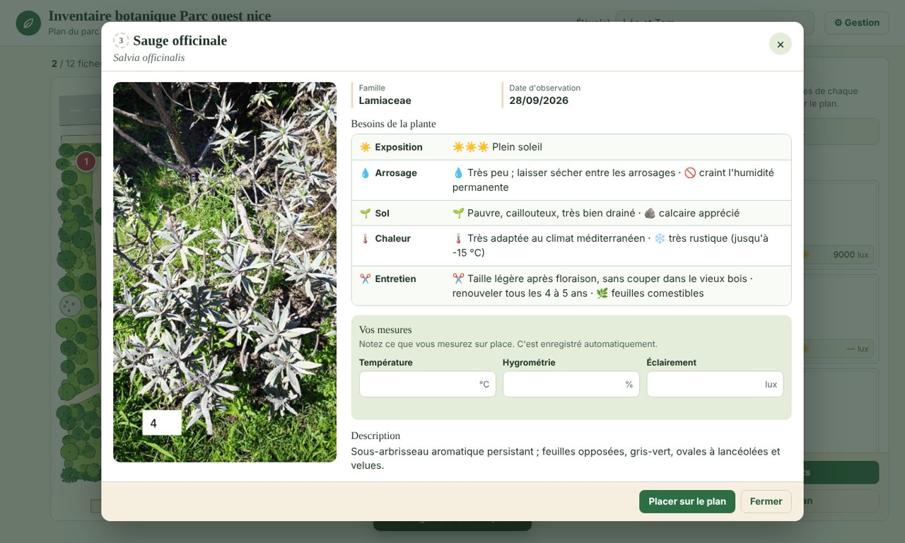
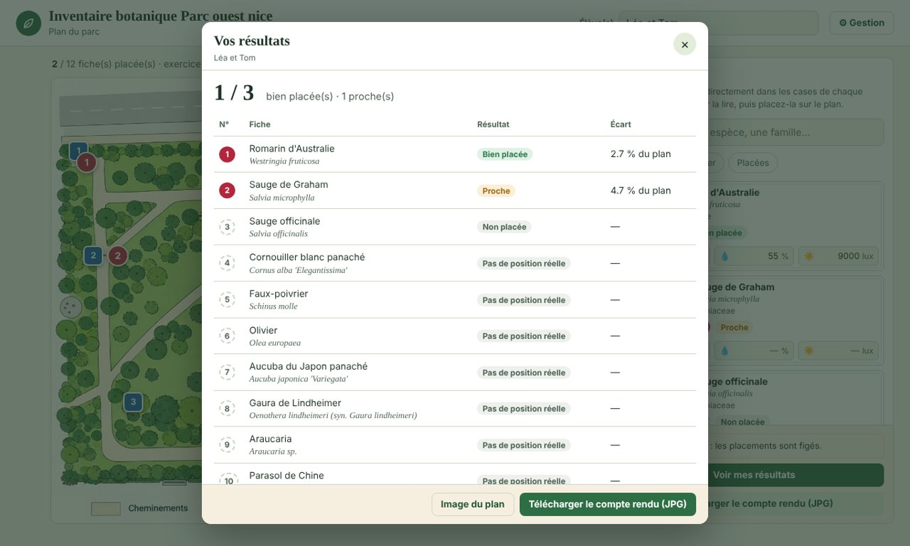
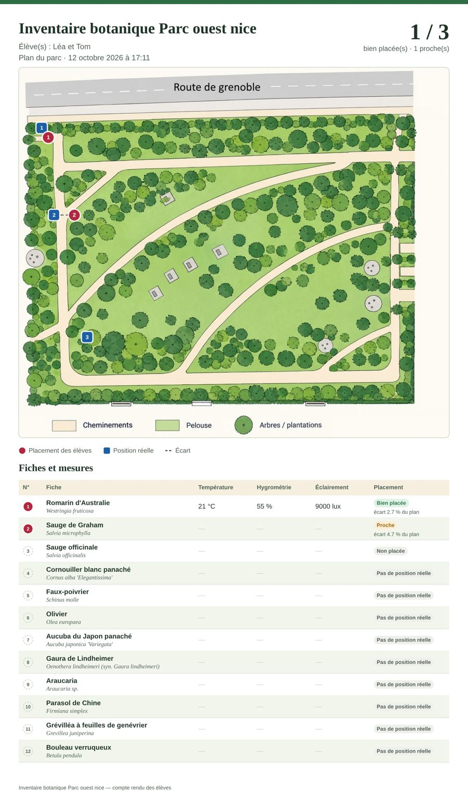
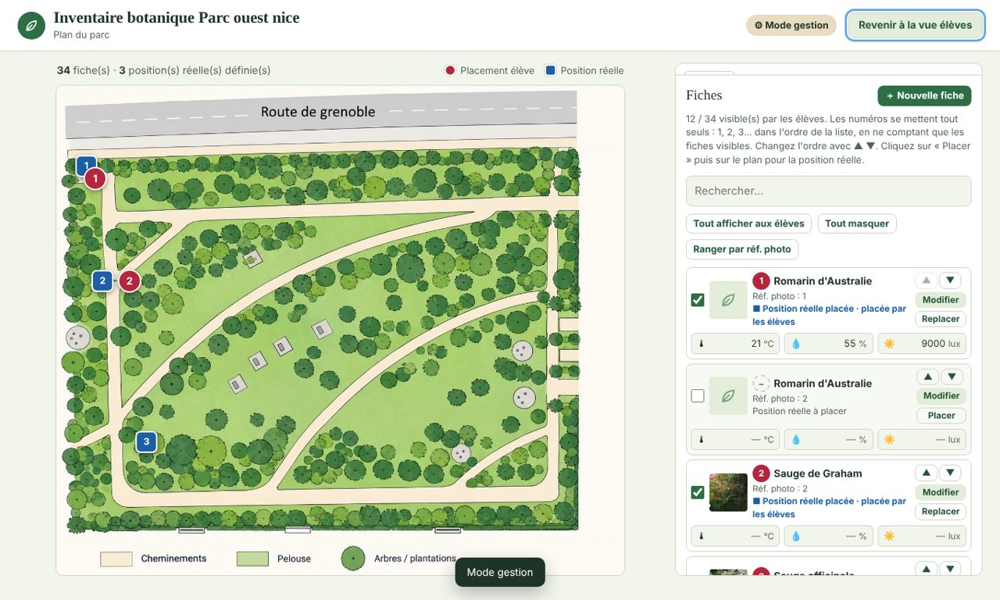
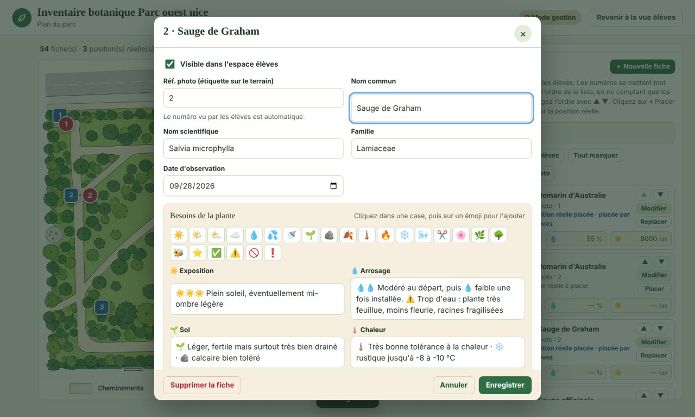
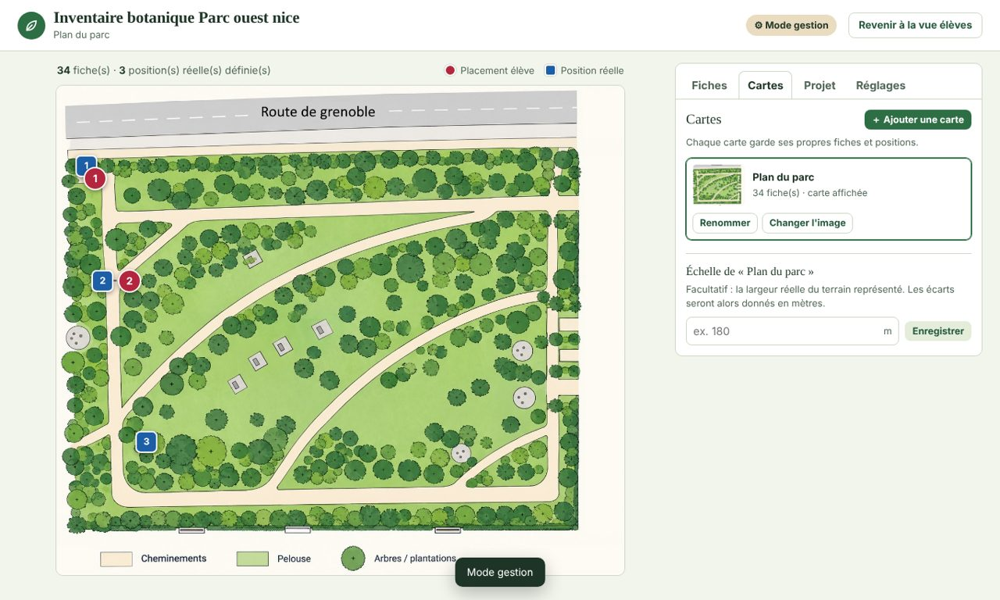
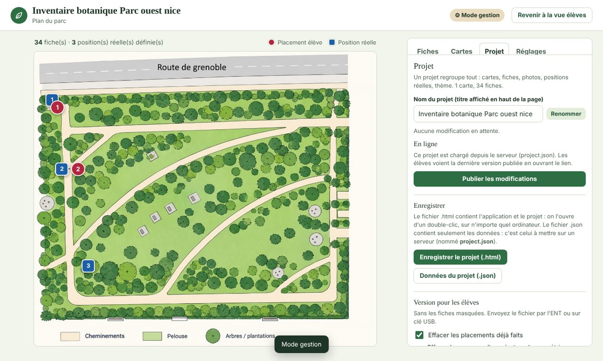
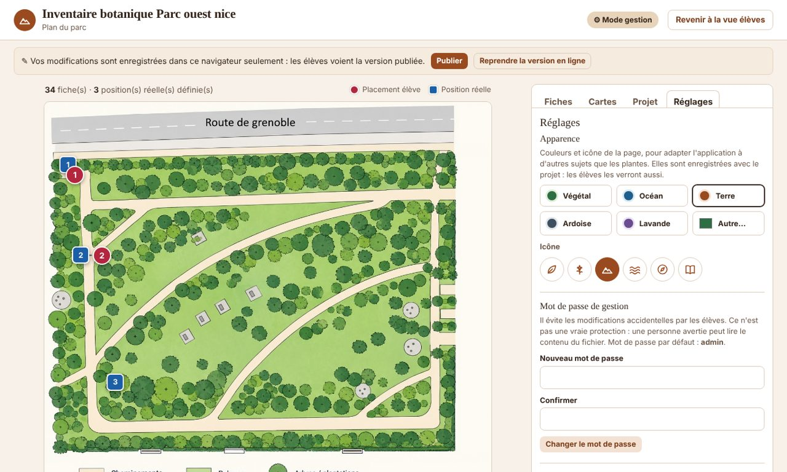
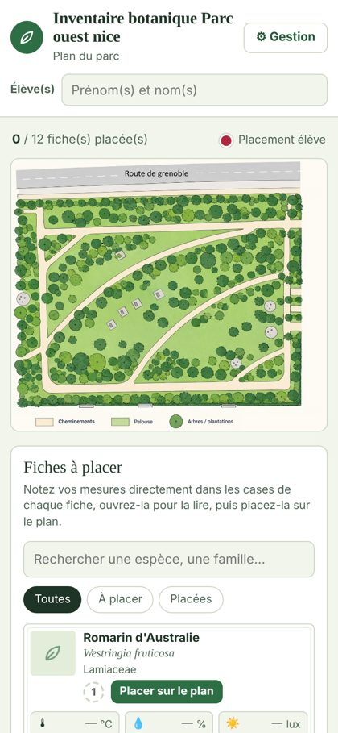

# Guide d'utilisation — Inventaire botanique, parc ouest (Nice)

L'application se compose de deux espaces très semblables : l'espace **élèves** et l'espace
**gestion** (enseignant), qui contient en plus tous les réglages.

On l'utilise soit **en ligne**, par l'adresse du site, soit **sans connexion**, en ouvrant le
fichier `.html` d'un double-clic.

---

## 1. Espace élèves

Les élèves écrivent d'abord leurs **prénoms et noms** en haut de la page : ils apparaîtront sur
le compte rendu.

Ils ont accès au plan et aux fiches des espèces à replacer. Chaque fiche est consultable, et
les **mesures relevées** (température, hygrométrie, éclairement) se notent soit directement
dans les petites cases de la fiche, soit dans la grande fiche ouverte : c'est enregistré tout
seul.

**Placer une espèce**

- Cliquer sur **Placer sur le plan**, puis cliquer à l'endroit voulu sur le plan.
  Un rond rouge portant le numéro de la fiche apparaît. On peut aussi faire glisser la fiche sur le plan.
- Chaque rond peut être déplacé ensuite à la souris (ou au doigt sur tablette). Un simple clic
  dessus ouvre la fiche.
- Les filtres **Toutes / À placer / Placées** et la recherche aident quand il y a beaucoup de fiches.

**Consulter une fiche**

Cliquer sur le nom d'une fiche l'ouvre en grand : photo, famille, besoins de la plante
(☀️ exposition, 💧 arrosage, 🌱 sol, 🌡️ chaleur, ✂️ entretien), mesures, description.
Un clic sur une photo l'affiche en plein écran (flèches ← → pour passer à la suivante).

**Vérifier**

Une fois l'exercice fait, **Vérifier mes placements** termine l'exercice : les placements sont
figés et les positions réelles apparaissent (carrés bleus, reliés au rond de l'élève par des
pointillés). Chaque fiche indique **Bien placée**, **Proche** ou **À revoir**, avec l'écart.

**Compte rendu**

**Télécharger le compte rendu (JPG)** crée une image avec les noms des élèves, le plan et
les repères, le score, et pour chaque fiche les mesures relevées et le résultat. C'est ce
fichier que les élèves rendent (ENT, mail…).

---

## 2. Espace gestion

On y accède avec le bouton **⚙ Gestion** et le mot de passe (**admin** par défaut — à changer,
voir Réglages). Quatre onglets : **Fiches**, **Cartes**, **Projet**, **Réglages**.
**Revenir à la vue élèves** pour voir ce que voient les élèves.

### Fiches

- **Case « élèves »** : la fiche est montrée aux élèves ou non.
- **🗑** supprime définitivement une fiche et ses photos (le bouton **Supprimer la fiche** existe aussi
  en bas de la fenêtre « Modifier »). **Supprimer les fiches masquées** retire d'un coup toutes les
  fiches décochées, après confirmation. Pour seulement cacher une fiche aux élèves, décochez-la.
- **Numéros** : ils se mettent tout seuls, 1, 2, 3… dans l'ordre de la liste, en ne comptant
  que les fiches visibles. Les flèches **▲ ▼** changent l'ordre. Une fiche masquée affiche « – ».
- **Réf. photo** : le repère libre utilisé sur le terrain ou sur les photos (« 12b »…). Le bouton
  **Ranger par réf. photo** remet la liste dans cet ordre.
- **Placer / Replacer** : cliquer, puis cliquer sur le plan à l'emplacement réel de la plante.
  La position réelle est un **carré bleu** ; on peut le déplacer à la souris.
- **Modifier** ouvre la fiche complète : noms, besoins de la plante avec une **barre d'émojis**
  (cliquer dans une case puis sur l'émoji), mesures, description, photos et vidéos. On choisit
  la photo qui sert de **vignette**. Sur PC, la touche Windows + « . » ouvre aussi tous les émojis.

- **Importer un tableau** : fiches préparées dans Excel, LibreOffice ou Google Sheets. Le
  **modèle** se télécharge juste à côté. Préférez le format **.xlsx**, qui garde les émojis.
  Une fiche qui existe déjà (même réf. photo, ou à défaut même nom) est complétée au lieu d'être
  créée en double.
- **Séance en cours** : **Voir les écarts** des élèves sur cet ordinateur, **Rouvrir l'exercice**,
  ou **Nouvelle séance** (efface placements, mesures et noms ; garde les fiches).

### Cartes

- Changer l'image du plan, ou ajouter d'autres cartes (chacune garde ses fiches).
- **Échelle** : la largeur réelle du terrain, en mètres. Les écarts des élèves seront alors
  donnés en mètres.

### Projet

- **Nom du projet** : le titre en haut de la page.
- **En ligne** (site hébergé) : **Publier les modifications** met la nouvelle version à disposition
  des élèves (mot de passe de publication fourni par la personne qui héberge le site). Tant que ce
  n'est pas publié, un bandeau le rappelle : les modifications ne sont que dans votre navigateur.
- **Enregistrer le projet (.html)** : un fichier qui contient l'application et tout le projet ;
  à garder comme sauvegarde, ou à ouvrir sur un autre ordinateur. **Données du projet (.json)** :
  le même contenu, au format attendu par le serveur.
- **Version pour les élèves** : sans les fiches masquées, en choisissant d'effacer ou non les
  placements et les mesures.
- **Ouvrir un projet** (un .html ou .json enregistré, y compris des anciennes versions) ou
  **Nouveau projet vide**.

### Réglages

- **Apparence** : thème de couleurs (Végétal, Océan, Terre, Ardoise, Lavande, ou une couleur au
  choix) et icône, pour utiliser l'application pour un autre sujet que les plantes. Les élèves
  voient le thème choisi.
- **Mot de passe de gestion**. Il évite les modifications par erreur, mais n'est pas une vraie
  protection : une personne avertie peut le contourner.
- **Identification par IA** : adresse d'un service qui propose un nom et des besoins à partir des
  photos d'une fiche (facultatif, à mettre en place à part).

---

## 3. Bon à savoir

- Tout ce qui est fait (fiches, placements, mesures) est **enregistré dans le navigateur** de
  l'ordinateur utilisé. Changer d'ordinateur ou de navigateur, c'est repartir de ce qui a été
  enregistré ou publié.
- Le travail des élèves **n'est pas effacé** quand l'enseignant publie une nouvelle version des fiches.
- Sur téléphone, le plan passe au-dessus et la liste des fiches en dessous.

